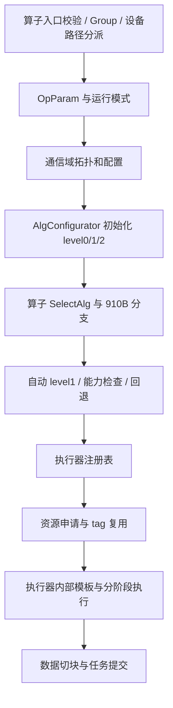

# 公共选择机制

## 选择不是一次 if，而是一条链

入口也可能提前结束：AllGather 的 `sendCount == 0` 返回成功，Group 模式暂存调用；V2 分派需由实际运行路径决定。[AllGather 入口](../../../../src/legacy/ascend910/framework/op_base/src/op_base.cc#L2650)

常规 host 执行路径创建新的算子对象，再选择算法；存在 AIV 缓存提前执行并返回，不能断言每次调用一定重选。[ExecOp 中选择位置](../../../../src/legacy/ascend910/framework/communicator/impl/hccl_communicator_host.cc#L4481)

三个输出分别是 `algType_`（各层类型）、`algName`（执行器注册名）和执行器内部 `TemplateType`。比如 `AllGatherMeshExecutor` 不代表上层一定用 Mesh，level1 可以是 Ring、NHR 或 HD。

## 符号与来源

| 符号 | 源码对应 | 含义与限制 |
|---|---|---|
| R | `userRankSize_` | 通信域总 rank 数 |
| M | `moduleNum_` | 聚合模块数量；不直接等同物理服务器数 |
| K | `deviceNumPerAggregation_` | 每个聚合组的设备数，需看是否非对称 |
| S | `isSingleMeshAggregation_` | 单个 Mesh 聚合组；不是简单 `serverNum==1` |
| Mesh | `topoType_` 在 NP/4P/2P/1P_MESH 中 | 执行器选择使用的拓扑判断 |
| L0Mesh | `IsAlgTypeLevel0Mesh(algType_.algoLevel0)` | 分层类型判断；与 Mesh 是不同变量 |
| O / G | OP_BASE / OPS_KERNEL_INFO_LIB | 单算子模式 / 图下沉模式；capture 可以发生在 O 中 |
| D | `count * SIZE_TABLE[type]` | AG 每 rank 发送字节，RS 每 rank 接收字节，AR 每 rank 完整输入字节 |
| DV | `max(counts) * SIZE_TABLE[type]` | V 算子的最大分块字节数，不是 sum(counts) |
| Bi / Bo | 输入/输出 CCL 大小 | 自动选择与分块使用实际容量，不只看环境变量文字 |
| A / Q | AivModeConfig / IsOnlyAivConfig | AIV 可用选择模式 / 强制要求最后为 AIV |
| det | DeterministicConfig | DISABLE / ENABLE / STRICT，不能混为一个布尔值 |

字段由 attrs 汇总为 `HcclTopoAttr/HcclAlgoAttr`，再由 `SetTopoAttr` 复制。[属性汇总](../../../../src/legacy/ascend910/framework/communicator/impl/hccl_communicator_attrs_host.cc#L1059) · [复制](../../../../src/legacy/ascend910/algorithm/impl/operator/coll_alg_operator.cc#L306)

`S` 的拓扑解析先检查设备是否都在当前 server，再查询链接；实际辅助函数遇到 `PXI_TYPE` 返回 false，其余类型没有在这里逐个拒绝。不要把注释“全 HCCS”扩大成代码未做的检查。[解析](../../../../src/legacy/ascend910/framework/common/src/topo/topoinfo_parse.cc#L341)

## 初始化的分层算法

[初始化选择](../../../../src/legacy/ascend910/algorithm/impl/alg_configurator.cc#L55)

1. 特殊非对称拓扑先处理：AR/AG/RS 等的非对称超节点分支可能设置 AHC；A2 组内卡数不一致等不适合分层的场景强制 Whole Ring，并关闭默认 level1 自动选择。必须沿源码顺序看，不能先套普通默认值。
2. 含 CPU rank 时有 Star 路径，本手册不按纯 A2 的 Mesh 分析它。
3. 普通路径初始化 level0、level1、level2；具体算子还会修正这些结果。

**level0：** 标卡 A2 的 1～8 卡范围默认 NP_SINGLE_RING；模块形态先按卡数生成类型，再检查 HCCS 计数。若 HCCS 计数为 `K*(K-1)` 或其两倍，A2 改为 NP_MESH。显式非 default/NA 的常见 level0 算法在这里告警后忽略；`null` 返回 RESERVED。[标卡](../../../../src/legacy/ascend910/algorithm/impl/alg_configurator.cc#L334) · [模块](../../../../src/legacy/ascend910/algorithm/impl/alg_configurator.cc#L370)

**level1：** Ring/HD/NHR/NHR_V1/NB/Pipeline 等可映射；Fullmesh/Pairwise 不作为普通 level1 接受，转默认。Pipeline 配置在 A2 非 O 模式转默认；AHC 对不支持的算子转默认。[配置限制](../../../../src/legacy/ascend910/algorithm/impl/alg_configurator.cc#L183)

初始默认 V1：`M>=8` 选 HD；`M<8` 时 `M==1` 或非 2 的幂选 Ring，其余选 HD。A2 默认状态会标记 `isAlgoLevel1Default_`，让后续按算子参数自动选择，而不是永久沿用初始化结果。[V1](../../../../src/legacy/ascend910/algorithm/impl/alg_configurator.cc#L270)

level2 默认 NHR；需要确认执行器是否创建并执行这一层，而不能从字段存在推断 A2 必有该通信平面。[level2](../../../../src/legacy/ascend910/algorithm/impl/alg_configurator.cc#L289)

## 配置读取与覆盖

环境配置从 `ParseHcclAlgo` 进入解析。`CommConfig::InitAlgoConfig` 先把环境配置复制到通信域配置表；`HcclCommConfig.hcclAlgo` 非空时再覆盖配置，空字符串保留原配置。有效 map 通过 `GetConfigHcclAlgoMap` 传入 attrs，成为 `HcclAlgoAttr.commAlgoConfig`。运行中修改 shell 的环境变量不会自动改写已经创建的对象。[初始配置](../../../../src/legacy/ascend910/framework/communicator/comm_config.cc#L70)

[环境读取](../../../../src/legacy/ascend910/framework/common/src/config/env_config.cc#L844) · [通信域配置](../../../../src/legacy/ascend910/framework/communicator/comm_config.cc#L420)

解析器算法 token 包括 `ring`、`H-D_R`、`NHR`、`NHR_V1`、`NB`、`pipeline`、`AHC`、`AHC_BROKE`。按源码大小写和校验规则使用。特定算子配置不支持 `level0:null`；AlltoAll 配置会复制给 V/VC。支持某字符串不代表具体算子、运行模式和执行器接受它。[解析器](../../../../src/legacy/ascend910/algorithm/impl/alg_env_config.cc#L99)

OnlyAIV：公共包装层拒绝不支持的算子与单 rank；host 执行层还检查实际算法描述 `isAivMode`，因此不能把候选条件中的 `||Q` 当成跳过所有限制。[公共检查](../../../../src/legacy/ascend910/algorithm/impl/operator/coll_alg_operator.cc#L122) · [最终检查](../../../../src/legacy/ascend910/framework/communicator/impl/hccl_communicator_host.cc#L4482)

## 公共能力判断展开

[能力判断](../../../../src/legacy/ascend910/platform/common/device_capacity.cc#L49)

- AIV Copy：FP16/FP32/FP64/BFP16，INT8/16/32/64，UINT8/16/32/64。某些错误日志的支持列表不完整，以函数条件为准。
- AIV Reduce：FP16/FP32/BFP16、INT8/16/32，且操作为 SUM/MAX/MIN。
- A2 SDMA Reduce：上述归约数据类型和操作；地址检查模 1，实际没有额外对齐限制，前提是设备查询成功。
- RDMA Reduce：同样的类型和操作，另外要求 Inf/NaN 溢出模式，且 dump debug 没有使能。仅凭类型支持不能推出 RDMA inline 支持。

[单/多 Mesh inline 判断](../../../../src/legacy/ascend910/algorithm/impl/operator/coll_alg_operator.cc#L775)

- `Is2U2PInfer`：A2、K=2、serverNum=1、meshAggregationRankSize=2、HCCS 计数=0。
- `SingleMeshInlineReduce`：A2、R!=1、(Mesh 或上述双卡形态)、SDMA 支持、S。
- `IsMultiMeshInlineReduce`：A2、Mesh、SDMA 支持、RDMA 支持、!S。
- 指针来源有区别：AR 常用用户指针，RS 的 O 分支常用 CCL 指针；以调用位置为准。

## 按调用参数自动选择 level1

[自动入口](../../../../src/legacy/ascend910/algorithm/impl/operator/coll_alg_operator.cc#L404) · [V2](../../../../src/legacy/ascend910/algorithm/impl/operator/coll_alg_operator.cc#L489)

只有 `!S && isAlgoLevel1Default_` 才执行 V2；算子还必须实际调用它。AG/AGV/AR/RS 的 O 路径调用；不能因公共函数存在就认为 Broadcast/Reduce 都使用这个成本模型。

**先判断 Pipeline，命中就返回，不比较成本：**

| 算子 | Pipeline 自动选择条件（另需调用入口条件） |
|---|---|
| AG / AGV | K!=1、D或DV >= p、L0Mesh、context<=65535 |
| RS 非确定性 | SDMA+RDMA 支持、det=DISABLE、K!=1、D>=p、L0Mesh、context<=65535 |
| RS 确定性 | SDMA+RDMA 支持、det=ENABLE、K>1、D>=p、D>=256 KiB、M>1、L0Mesh、context<=65535 |
| AR 非确定性 | SDMA+RDMA 支持、det=DISABLE、K!=1、floor(D/(M*K))>=q、!isAivMode、L0Mesh、context<=65535 |
| AR 确定性 | SDMA+RDMA 支持、det=ENABLE、K>1、floor(D/(M*K))>=1 MiB、!isAivMode、L0Mesh、context<=65535 |

`p=32 KiB`（RdmaLite）或 `2 MiB`（非 Lite）；`q=1 MiB`（Lite）或 `2 MiB`。AR 确定性分支写死 1 MiB，没有沿用 q。这是源码事实。

源码注释说明：非 Lite 的任务下发代价较高，需要更大数据量掩盖开销。这是明确动机；阈值在具体硬件上最优与否没有测量。

**不选 Pipeline 时比较静态模型：** `x=min(curSize,cclBufferSize)`，延迟固定 60 μs；A2 level1 带宽通常是 `20*1024^3 B/s`，`R==2*K` 时特殊取 `54.4*1024^3 B/s`。源码判断没有 serverNum 条件，不能把注释“单 server”加进表达式。[带宽](../../../../src/legacy/ascend910/platform/common/device_capacity.cc#L141)

AG/RS 令 `T=x*R/B*10^6`：Ring=`(M-1)*60+(M-1)/M*T`；NHR=`ceil(log2(M))*60+(M-1)/M*T`；HD 为 2 的幂时=`log2(M)*60+(M-1)/M*T`，否则=`ceil(log2(M))*60+(2*M-1)/M*T`。

AR 令 `T=x/K/B*10^6`，Ring/NHR/HD 的上述表达式整体乘 2。AGV 只比较 Ring/NHR，不比较 HD。比较均为严格 `<`，同成本优先 Ring，然后 NHR，然后 HD。[AG 模型](../../../../src/legacy/ascend910/algorithm/impl/operator/coll_alg_operator.cc#L587) · [AR 模型](../../../../src/legacy/ascend910/algorithm/impl/operator/coll_alg_operator.cc#L672)

因此在这些表达式有效的正数据域中，AG/RS/AR 的非 Pipeline 默认 V2：M=2 时 Ring；M>=3 时 NHR（HD 与 NHR 打平时不覆盖）。这与“初始化 4 组默认 HD”不同。成本模型有数据项，不代表模型中每个候选之间都存在数据量交叉点。

## context 容量与 AHC

[context 公式](../../../../src/legacy/ascend910/algorithm/impl/operator/coll_alg_operator.cc#L450)

令 `E=(det==ENABLE && op为AR/RS)`，每步 context `c=5*(K-1)+7+1+(E?K-1:0)`。AG/AGV/RS 基数 `M*c+5`；AR 将基数乘 2；E 为真再加 `M-1`。AlltoAll 系列是 `M*c+4+1+M`，E 为假。源代码使用 u32；超出整数范围的非真实拓扑不作为可运行场景。

AHC 进入时：组内卡数非对称直接返回；否则 A2 需要 `level0==RESERVED` 且 level1=AHC/AHC_BROKE，其他 A2 level1-AHC 组合报参数错误。随后子组大小不一致保留 AHC，否则 BROKE；AG/RS 且每 server 设备数!=1 强制 BROKE；关闭 auto-select 则返回 AHC。只允许已有 AHC 自适应改成 BROKE，已有 BROKE 不会在这里改回 AHC。组间拼接：子组数<=3 用 Ring，>3 用 NHR。[AHC](../../../../src/legacy/ascend910/algorithm/impl/operator/coll_alg_operator.cc#L895)
