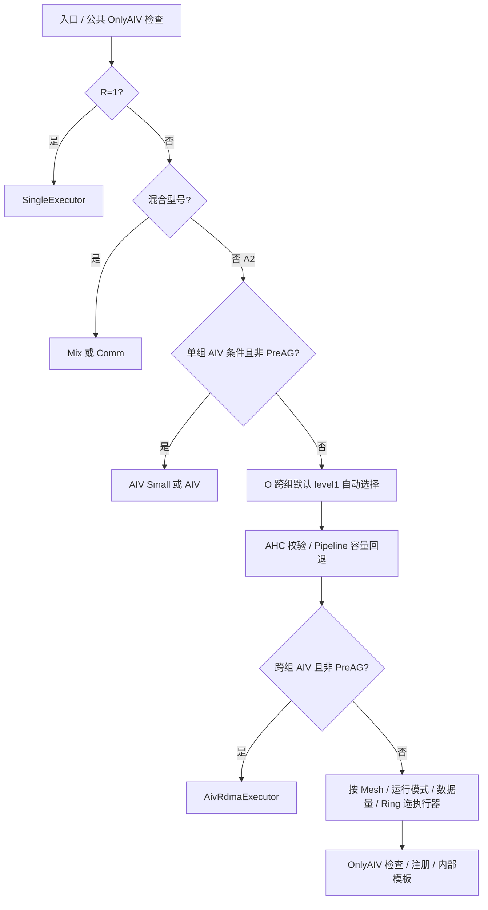

# AllGather：完整选择与切换示范

入口：[SelectAlg](../../../../src/legacy/ascend910/algorithm/impl/operator/all_gather_operator.cc#L38)。A2 主判断：[SelectAlgfor910B](../../../../src/legacy/ascend910/algorithm/impl/operator/all_gather_operator.cc#L131)。符号见 [公共机制](01_common.md)。以下假设输入合法、设备路径确实进入传统选择器，且初始 `algName` 为空。

## 先处理优先级和中间算法类型

| 顺序 | 完整当前条件 | 结果 | 理由/证据性质 |
|---|---|---|---|
| 1 | R=1 | AllGatherSingleExecutor，直接返回 | 单 rank 不需要卡间收集；地址不同时复制（代码事实） |
| 2 | R>1 且混合型号 | gcdDeviceNumPerAggregation>1：MixExecutor+NHR；否则 Comm+Ring | 混合路径支持限制（代码事实）；不会进入 910B 专有选择器 |
| 3 | 非混合 A2；A、S、Copy 类型支持、(D<=256 MiB 或 Q)，且 tag 不是 AlltoAll 预处理 AG | O 且 D<=700 KiB：MeshAivSmallCount；否则 MeshAiv，直接返回 | AIV 实现分界；阈值最优性未证实 |
| 4 | 未提前返回，O 且 !S | 默认 level1 才执行 V2；CCL 参数为 floor(Bo/R) | Pipeline 先行，否则成本模型；显式类型通常跳过自动比较 |
| 5 | 当前 level1 为 AHC/AHC_BROKE | 调用 AHC 检查与子组选型 | A2 普通 level1-AHC 会报错，需看公共页的 RESERVED 前置 |
| 6 | 当前 level1=Pipeline，计算 context>65535 | level1 改 HD | 子图容量限制；即使显式指定 Pipeline 也不能免除 |

AlltoAll 的预处理 AG 判断是 `param.tag == HCCL_ALLTOALL_PARA_ALLGATHER`，它会避开两条 AIV 选中路径。这个用途限制不能被“数据足够小”取代。

## 最终执行器决策表

下表从上往下，后一行继承前面不命中；完整名称前缀均为 `AllGather`，未写缩写的 Comm 保留原名。

定义跨组 AIV 条件：

```text
CrossCount = !S && !multiModuleDiffDeviceNumMode
             && (Q || ((serverNum 是正的 2 的幂 || D<=128 KiB)
                        && D*R<=16 MiB && D<=256 KiB))
CrossAIV = A && Copy支持 && Mesh && O && Bi>=16 MiB && Bo>=16 MiB && CrossCount
PreAG = tag 为 AlltoAll 预处理 AG
```

| 顺序 | 条件 | 执行器后缀 |
|---|---|---|
| 1 | CrossAIV && !PreAG | AivRdmaExecutor |
| 2 | Mesh && O && S | MeshOpbaseExecutor |
| 3 | Mesh && O && !S && level1=Pipeline | MeshOpbasePipelineExecutor |
| 4 | Mesh && G && M>1 && K>1 && (D>1 MiB 或 M<=4 或 level1=Pipeline) | MeshGraphPipelineExecutor |
| 5 | Mesh && (O 或 D>1 MiB) | MeshExecutor |
| 6 | Mesh && G | MeshGraphExecutor |
| 7 | 非 Mesh，topoType=NP_SINGLE_RING | RingExecutor |
| 8 | 非 Mesh/非上述 Ring | AllGatherComm |

Q 在单组 AIV 提前返回处允许绕过 256 MiB 上限；跨组允许绕过部分数据量/服务器数量条件，但不能绕过 Copy 类型、Mesh、O、Bi/Bo>=16 MiB、组内卡数一致等限制。非 AIV 候选最终可能被 OnlyAIV 校验拒绝，不能当作成功回退。

G 分支 `D>1 MiB` 是严格大于。D=1 MiB 时是否 GraphPipeline 还要看 M、K；例如 M=4、K>1 时仍可走 GraphPipeline，M=8 则不一定。



## 执行器下面还选什么

注册表、模板调用和模板注册入口可在 [源码索引](source_index.md) 的 AllGather 部分逐项跳转。下面是可直接用于推导的主要链。

| 执行器 | 实际行为与内部选择 |
|---|---|
| Single | inputPtr==outputPtr 不做 D2D 复制；否则复制 D 字节，不发生跨 rank 传输 |
| MeshOpbase | 用 MESH_DIRECT 模板，面向单 Mesh O 路径；它的调用/指针组织不同于普通 Mesh |
| MeshOpbasePipeline | 使用 ALL_GATHER_PIPELINE；大数据仍受分片、缓冲区容量约束 |
| MeshGraphPipeline | 使用 ALL_GATHER_GRAPH_PIPELINE；不能仅凭名称推断它等于 level1=Pipeline |
| MeshExecutor | A2 机内选 MESH_ATOMIC；上层按 level1 选择下表模板 |
| MeshGraphExecutor | 上层类型选择类似普通 Mesh，A2 机内仍选 MESH_ATOMIC；数据组织/执行顺序不同 |
| RingExecutor | 机内 Ring 组织，上层按 level1 选择 Ring/NHR/NHRV1/NB/递归 HD |
| AIV 族 | 沿 AIV 执行器和 `aiv_all_gather_op.h` 到内核；不能用传统 TemplateType 注册表替代这条链 |
| Comm | 打平或特殊拓扑的兼容执行器；内部按 whole/组合平面及 level1 分派，详见索引中的函数与继承链 |

[普通 Mesh KernelRun](../../../../src/legacy/ascend910/algorithm/impl/coll_executor/coll_all_gather/coll_all_gather_mesh_executor.cc#L72) · [Ring 内部选择](../../../../src/legacy/ascend910/algorithm/impl/coll_executor/coll_all_gather/coll_all_gather_ring_executor.cc#L74)

普通 Mesh 上层选择按顺序：`level1==Ring || (isDiffDeviceModule && serverNum==1)` → Ring；否则 NHR → NHR，NHR_V1 → NHRV1，NB → NB；其余 → RECURSIVE_HALVING_DOUBLING。**单 server 跨 module 的例外优先于当前 level1 值**。调用前后还检查子通信域大小，模板出现不意味着该场景一定有跨服务器传输。

模板实现入口由 `REGISTER_TEMPLATE` 决定，见证据索引。分析理由的机制推断：Mesh 利用多流/多链接并行；Ring 分步转发；HD/NHR 减少上层轮次；Pipeline 重叠分阶段工作。哪种实际更快还取决于硬件和实现调度开销。

## 分块不是重新选算法

[Orchestrate](../../../../src/legacy/ascend910/algorithm/impl/coll_executor/coll_all_gather/coll_all_gather_executor.cc#L21) 的 G 路径直接 KernelRun，O 单 rank 单独处理，普通 O 多 rank 走 RunLoop 或 RunLoopV；零拷贝描述还有自己的分阶段路径。

普通 Mesh 每轮最大 count：`floor(floor(Bo/R)/HCCL_MIN_SLICE_ALIGN)*HCCL_MIN_SLICE_ALIGN/unitSize`，使用整数运算。D 增大超过一轮容量可能增加循环次数，**不能直接说发生 Ring→Mesh 切换**。

## 具体推导示例

以下均是静态场景，不是硬件执行结果，假设输入和资源合法。

- R=1、Q=false：Single；它不会经过 700 KiB 分界。
- R=8、S、A、FP32、O：D=700 KiB 是 AIV Small；D=700 KiB+4 是 AIV；D>256 MiB 且 Q=false 脱离单组 AIV，Mesh 时是 MeshOpbase。
- R=16、K=8、M=2、!S、Mesh、L0Mesh、O、A=false、默认 level1、Lite：D=32 KiB 命中 Pipeline；D=32 KiB-4 不命中 Pipeline，V2 比较后是 Ring，对应 MeshExecutor。
- 同一跨组场景改 A=true、Bi/Bo>=16 MiB、D=32 KiB：CrossAIV 优先，最终 AivRdma；level1 已自动选 Pipeline 不代表最终采用传统 Pipeline 执行器。
- G、Mesh、A=false、K>1、M=8：D=1 MiB 为 MeshGraph，D=1 MiB+4 为 MeshGraphPipeline；M=4 时等于 1 MiB 也可能为 GraphPipeline。
- 配置 Pipeline、Q=false、未提前进入 AIV、context=65536：回退 HD；context=65535 不因容量检查回退。

上例只覆盖主要边界，全部执行器候选和异常入口见 [验证页](06_switch_validation.md) 与源代码证据，不把任意构造的 M/K 视为真实可用硬件拓扑。
